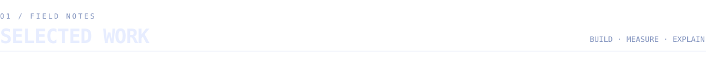
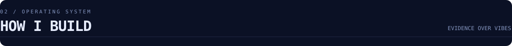
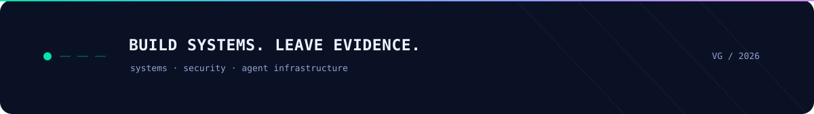

 

<a href="https://www.linkedin.com/in/varun-gore-14187632a/">LinkedIn</a>&nbsp;&nbsp;·&nbsp;&nbsp;<a href="mailto:varungore1@gmail.com">Email</a>&nbsp;&nbsp;·&nbsp;&nbsp;<a href="https://github.com/VarunGore36">GitHub</a>&nbsp;&nbsp;·&nbsp;&nbsp;<a href="https://discord.com/users/1279066758300569623">Discord</a>

 

> I build infrastructure that does more than work—it can account for itself. My interests sit at the intersection of systems engineering, agent security, reproducible measurement, and developer tooling.

<table>
<tr>
<td width="33%" valign="top">
01 / CURRENT FOCUS  
<b>Agent systems that fail safely</b>  
Constrained tools, least-privilege credentials, controlled network access, and evidence for every consequential action.
</td>
<td width="33%" valign="top">
02 / DEFAULT MODE  
<b>Evidence before confidence</b>  
Benchmarks need context. Claims need boundaries. Unverified results stay visibly unverified.
</td>
<td width="33%" valign="top">
03 / BUILDING WITH  
<b>Rust · Python · Linux</b>  
Systems software, reproducible research, AI evaluation, and tooling people can inspect and trust.
</td>
</tr>
</table>

 

<table>
<tr>
<td width="50%" valign="top">

### [Toolcage](https://github.com/VarunGore36/toolcage)

LOCAL-FIRST AGENT SECURITY RUNTIME

A Rust runtime that puts policy, credential brokering, controlled egress, and tamper-evident audit logs between an AI agent and everything it touches.

`Rust` `Linux` `MCP` `security`

<b>72 tests</b> · 404 ns policy-decision p99 · alpha / not independently reviewed

</td>
<td width="50%" valign="top">

### [REA](https://github.com/VarunGore36/rea)

OPEN-SOURCE CONTRIBUTION · AGENTIC REVERSE ENGINEERING

Contributed to a project for reverse engineering software with agents, from observed behavior down to native binaries.

`TypeScript` `agents` `reverse engineering`

Focused on making deep analysis workflows more reliable and usable from the command line.

</td>
</tr>
<tr>
<td width="50%" valign="top">

### [ECC](https://github.com/VarunGore36/ECC)

OPEN-SOURCE CONTRIBUTION · AGENT HARNESS ENGINEERING

Contributed to an agent-harness optimisation system spanning skills, memory, security, and research-first development workflows.

`JavaScript` `Codex` `developer tooling`

Built for practitioners working across Claude Code, Codex, Cursor, OpenCode, and related environments.

</td>
<td width="50%" valign="top">

### [AstralProject](https://github.com/VarunGore36/AstralProject)

REPRODUCIBLE CRYPTO-MARKET MEASUREMENT

Lossless market-data capture, deterministic replay, and honest cost models for research and simulation.

`Rust` `market data` `replay`

<b>300 / 300</b> top-of-book checks · [live project](https://astral-project-ruddy.vercel.app/)

</td>
</tr>
<tr>
<td width="50%" valign="top">

### [ChainLens](https://github.com/VarunGore36/ChainLens)

ETHEREUM INDEXING, BUILT FOR FAILURE MODES

A concurrent Rust indexer with canonical-chain tracking, reorg handling, crash-safe recovery, and PostgreSQL storage.

`Rust` `Tokio` `PostgreSQL`

<b>232 tests</b> · 150 ns/block decode benchmark · [live project](https://chain-lens-chi.vercel.app/)

</td>
<td width="50%" valign="top">

### [ENAMEL-Extended](https://github.com/VarunGore36/ENAMEL-Extended)

LLM CODE-EFFICIENCY EVALUATION

An open reimplementation and extension of the ENAMEL benchmark for LLM-generated code.

`Python` `evaluation` `LLMs`

<b>13 models</b> · 161 problems · 612 tests · [live project](https://enamel-extended.vercel.app)

</td>
</tr>
</table>

More experiments: <a href="https://github.com/VarunGore36/DepLens">DepLens</a> — testing whether dependency graphs, code usage, and Git history can predict what a change will break.

  

  

<table>
<tr>
<td width="50%" valign="top">

#### Determinism before speed

Same input, same output, every replay. Optimisation is only interesting when the system remains explainable.

</td>
<td width="50%" valign="top">

#### Fail closed

If an action cannot be authorised, isolated, or recorded, it should not quietly proceed with weaker guarantees.

</td>
</tr>
<tr>
<td width="50%" valign="top">

#### Measure the boundary

Every result has a method, environment, and limit. A benchmark without context is marketing, not evidence.

</td>
<td width="50%" valign="top">

#### Keep the rough edges visible

Incomplete work, uncertain conclusions, and known failure modes are part of the engineering record.

</td>
</tr>
</table>

 

 

 

