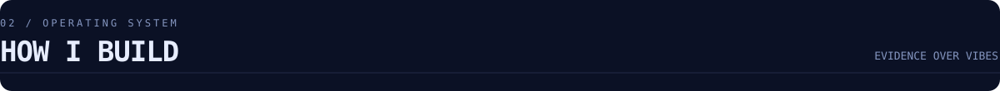
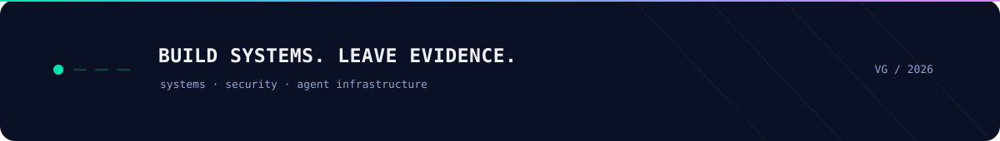

 

<a href="https://github.com/VarunGore36">GitHub</a>&nbsp;&nbsp;·&nbsp;&nbsp;<a href="https://www.linkedin.com/in/varun-gore-14187632a/">LinkedIn</a>&nbsp;&nbsp;·&nbsp;&nbsp;<a href="mailto:varungore1@gmail.com">Email</a>&nbsp;&nbsp;·&nbsp;&nbsp;<a href="https://discord.com/users/1279066758300569623">Discord</a>

 

I build infrastructure that can explain itself: systems with explicit boundaries, reproducible results, and a record of what happened when things go wrong.

My work lives around systems engineering, agent security, developer tooling, and measurement that holds up outside a demo.

## Right now

| Focus | What that means in practice |
| --- | --- |
| **Agent systems that fail safely** | Constrained tools, least-privilege credentials, controlled egress, and audit trails for consequential actions. |
| **Evidence before confidence** | Benchmarks include their environment and limits; unverified claims stay visibly unverified. |
| **Rust at the core** | Systems software, data pipelines, and tooling that are fast enough to use and simple enough to inspect. |

 

## Selected work

### [Toolcage](https://github.com/VarunGore36/toolcage)

**A local-first security runtime for AI agents.** Toolcage places policy enforcement, credential brokering, controlled network access, and tamper-evident audit logs between an agent and the systems it can affect.

`Rust` · `Linux` · `MCP` · `Security` 
72 tests · 404 ns policy-decision p99 · Alpha; not independently reviewed

### [AstralProject](https://github.com/VarunGore36/AstralProject)

**Reproducible crypto-market measurement.** Lossless market-data capture, deterministic replay, and honest cost models for research and simulation—not just backtests that look good in hindsight.

`Rust` · `Market data` · `Replay` 
300/300 top-of-book checks · [Project site](https://astral-project-ruddy.vercel.app/)

### [ChainLens](https://github.com/VarunGore36/ChainLens)

**Ethereum indexing designed around failure modes.** A concurrent Rust indexer with canonical-chain tracking, reorg handling, crash-safe recovery, and PostgreSQL storage.

`Rust` · `Tokio` · `PostgreSQL` 
232 tests · 150 ns/block decode benchmark · [Project site](https://chain-lens-chi.vercel.app/)

### [ENAMEL-Extended](https://github.com/VarunGore36/ENAMEL-Extended)

**An open evaluation harness for LLM-generated code.** A reimplementation and extension of ENAMEL built to make code-efficiency evaluation easier to run, inspect, and compare.

`Python` · `LLM evaluation` · `Reproducibility` 
13 models · 161 problems · 612 tests · [Project site](https://enamel-extended.vercel.app/)

### Open-source contributions

- [REA](https://github.com/VarunGore36/rea) — making agentic reverse-engineering workflows more reliable and useful from the command line.
- [ECC](https://github.com/VarunGore36/ECC) — contributing to an agent-harness optimisation system spanning skills, memory, security, and research-first workflows.
- [DepLens](https://github.com/VarunGore36/DepLens) — exploring whether dependency graphs, code usage, and Git history can predict what a change will break.

 

 

## How I build

- **Determinism before speed.** Same input, same output, every replay. Optimisation only matters when the system remains explainable.
- **Fail closed.** If an action cannot be authorised, isolated, or recorded, it should not quietly proceed with weaker guarantees.
- **Measure the boundary.** Every result has a method, environment, and limit. A benchmark without context is marketing, not evidence.
- **Keep the rough edges visible.** Incomplete work, uncertain conclusions, and known failure modes belong in the engineering record.

 

 

 

