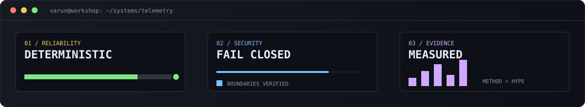
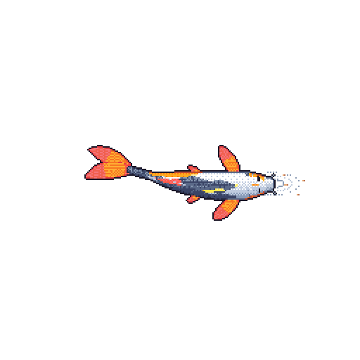
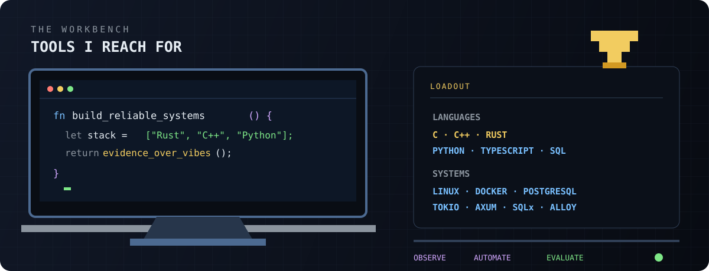
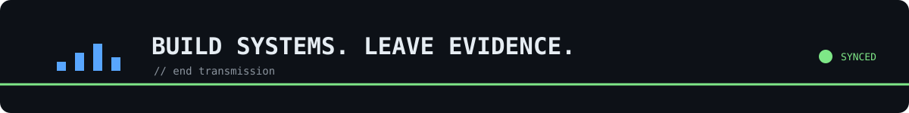

<div align="center">



<br />

[](https://github.com/VarunGore36)
[](https://www.linkedin.com/in/varun-gore/)
[](https://discord.com/users/1279066758300569623)
[](mailto:varungore1@gmail.com)

<sub><code>DISCORD · 1279066758300569623</code></sub>

</div>


## `WELCOME TO THE WORKSHOP`

I build dependable systems for consequential work: infrastructure that is fast under pressure, clear at its boundaries, and candid about its failure modes. My home turf is systems engineering, agent security, developer tooling, and measurement that survives contact with reality.



<div align="center">
  
  <br />
  <sub><i>Activity rendered nightly as a living <a href="https://github.com/yalongwastaken/git-koi">Git Koi</a>.</i></sub>
</div>


## `SELECTED BUILDS`

| | Build | What it does |
| :--: | :-- | :-- |
| `01` | [**Toolcage**](https://github.com/VarunGore36/toolcage) | A local-first security runtime for AI agents: policy enforcement, credential brokering, controlled egress, and tamper-evident audit logs. `Rust` `Linux` `MCP` `Security` |
| `02` | [**AstralProject**](https://github.com/VarunGore36/AstralProject) | Reproducible crypto-market measurement through lossless capture, deterministic replay, and honest cost models. [Project site](https://astral-project-ruddy.vercel.app/) |
| `03` | [**ChainLens**](https://github.com/VarunGore36/ChainLens) | An Ethereum indexer built for failure modes: reorg-aware, crash-safe, concurrent, and backed by PostgreSQL. [Project site](https://chain-lens-chi.vercel.app/) |
| `04` | [**ENAMEL-Extended**](https://github.com/VarunGore36/ENAMEL-Extended) | An open harness for running, inspecting, and comparing LLM-generated-code evaluations. [Project site](https://enamel-extended.vercel.app/) |


## `THE ARMORY`



<details>
<summary><b>full stack manifest</b></summary>

<br />

`C` · `C++` · `Rust` · `Python` · `TypeScript` · `SQL` · `Bash`<br />
`Linux` · `Docker` · `PostgreSQL` · `GitHub Actions` · `Prometheus` · `Grafana`<br />
`Tokio` · `Axum` · `SQLx` · `Alloy` · `pytest` · `Ruff` · `uv` · `NumPy` · `Matplotlib` · `vLLM` · `EvalPlus`

</details>


## `LAST 24 HOURS ON GITHUB`

_Public repositories I created or pushed to during the last 24 hours, across GitHub._

<!-- RECENT_REPOS:START -->
| Project | Activity in the last 24 hours |
| :-- | :-- |
| [**regime-classifier**](https://github.com/VarunGore36/regime-classifier) | No description yet. · `Python`<br /><sub>activity Nov 2026</sub> |
| [**GeoMind**](https://github.com/VarunGore36/GeoMind) | AI-powered geospatial intelligence API that converts satellite imagery and geographic datasets into structured, actionable intelligence. · `Python`<br /><sub>activity Nov 2026</sub> |
<!-- RECENT_REPOS:END -->

```text
// operating system
determinism > vibes
fail closed
measure the boundary
keep the rough edges visible
```

<div align="center">

<a href="https://discord.com/users/1279066758300569623"></a>



<sub>open to systems, security, and developer-tooling conversations</sub>

</div>
